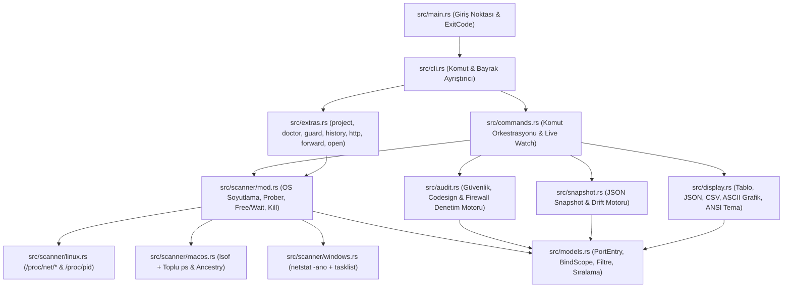

# Clous — Kapsamlı Sistem Mimarisi ve Kullanım Rehberi

**Clous**, Rust (Edition 2024) ve yerel macOS SwiftUI ile **sıfır harici bağımlılık** (yalnızca `std` ve Apple SDK) kullanılarak geliştirilmiş; yüksek hızlı, hafif ve çapraz platformlu bir port izleme, güvenlik denetimi, adli süreç inceleme, proje port haritalama ve ağ analiz sistemidir.

---

## 1. Tasarım Felsefesi ve Mimari

Clous üç temel prensip üzerine kuruludur:

1. **Sıfır Harici Bağımlılık (`Cargo.toml` ve `Package.swift` içinde harici paket yok):**
   - Tedarik zinciri (supply-chain) riskini sıfıra indirir.
   - Derleme süresi saniyeler sürer, ortaya tek bir küçük native binary (`opt-level = 3`, `lto = true`, `strip = true`) ve hafif bir macOS masaüstü uygulaması (`Clous.app`) çıkar.
2. **İşletim Sistemine Özgü En Hızlı Veri Toplama:**
   - Her platformda en doğrudan ve en düşük maliyetli mekanizmayı kullanır.
3. **İnsan + Makine Dostu Çıktı & Çift Dilli Arayüz:**
   - Terminalde renkli tablolar, ASCII çubuk grafikleri ve titremesiz canlı panel (TUI); macOS uygulamasında **İngilizce / Türkçe** dil desteği, doğal dil komut çözümleyici ve Apple Liquid Glass arayüz; otomasyon ve CI/CD için `--json`, `--csv`, `--compact`, `--plain` ve anlamlı çıkış kodları (`0`, `1`, `2`).

### Modül Mimarisi



---

## 2. Sistem Nasıl Çalışır? (Teknik Derinlik)

### 2.1. İşletim Sistemine Göre Soket ve Süreç Toplama

| Platform | Yöntem | Toplanan Veriler | Performans Özelliği |
|---|---|---|---|
| **Linux** | `/proc/net/{tcp,tcp6,udp,udp6}` + `/proc/<pid>/fd` + `/proc/<pid>/{comm,cmdline,status}` + `/etc/passwd` | Protokol, yerel/uzak IP:Port, durum, PID, PPID, kullanıcı adı, VmRSS bellek, tam komut satırı | **Sıfır alt süreç** — doğrudan kernel sanal dosya sisteminden okur |
| **macOS** | `lsof -nP -iTCP -iUDP` + tek seferlik toplu `ps -o pid=,ppid=,rss=,user=,args= -p <pids>` | Protokol, yerel/uzak IP:Port, durum, PID, PPID, kullanıcı, RSS bellek, tam komut satırı | N süreç için N kez `ps` çalıştırmak yerine **tek toplu `ps` çağrısı** yapar |
| **Windows** | `netstat -ano` + `tasklist /FO CSV /NH` | Protokol, yerel/uzak IP:Port, durum, PID, süreç adı, bellek kullanımı | Harici kurulum veya PowerShell gerektirmez |

### 2.2. Bind Kapsamı (Exposure) Sınıflandırması

Her dinleyen soketin yerel IP adresi otomatik olarak analiz edilerek 4 güvenlik kapsamından birine atanır:

- **`LOCAL` (Yeşil):** `127.0.0.1`, `::1`, `localhost` — yalnızca yerel makineden erişilebilir.
- **`LAN` (Camgöbeği):** Özel ağlar (`10.0.0.0/8`, `172.16.0.0/12`, `192.168.0.0/16`), link-local (`169.254.x.x`, `fe80::/10`) ve IPv6 ULA (`fc00::/7`).
- **`ALL(*)` (Sarı):** `0.0.0.0`, `::`, `*` — makinedeki **tüm ağ arayüzlerinden** (LAN, Wi-Fi, VPN, varsa genel IP) erişime açık.
- **`PUBLIC` (Kırmızı):** Doğrudan yönlendirilebilir genel (public) IP adresine bağlı.

### 2.3. Otomatik Runtime / Container Etiketleme

Süreç adı ve komut satırı incelenerek soketlere bağlam etiketleri eklenir:
- `[container]` (Docker, containerd, Podman, Colima, OrbStack)
- `[database]` (PostgreSQL, MySQL/MariaDB, Redis, MongoDB)
- `[proxy/web]` (Nginx, Apache/httpd, Caddy, HAProxy, Envoy)
- `[js/ts]` (Node.js, Bun, Deno)
- `[python]` (Python, Uvicorn, Gunicorn)
- `[jvm]` (Java, Gradle)

### 2.4. Titremesiz Canlı İzleme (`watch` — In-Place Alternate Screen)

`clous watch` komutu standart ekrana alt alta yeni metin blokları basmak yerine gerçek bir terminal paneli gibi çalışır:

1. **Alternate Screen Buffer (`\x1b[?1049h`)** açılır ve imleç gizlenir (`\x1b[?25l`). Böylece terminal geçmişiniz (scrollback) kirlenmez.
2. Her yenileme döngüsünde tüm ekran (üst istatistik şeridi + port tablosu + son değişiklikler) tek bir bellek tamponunda oluşturulur.
3. `\x1b[H`, `\x1b[K` ve `\x1b[J` dizileriyle **tek bir atomik `write_all` + `flush`** çağrısında ekrana yazılır — sıfır titreme (flicker-free).
4. `SIGINT` (`Ctrl+C`) yakalanır; RAII `WatchTerminalGuard` sayesinde imleç yeniden görünür yapılır ve ana terminal ekranınız bozulmadan geri yüklenir.

### 2.5. Güvenlik & Soket Sağlığı Denetim Motoru (`audit`)

Sistem 100 puan üzerinden başlar ve tespit edilen bulgulara göre puan düşerek `A–F` notu hesaplar:

| Seviye | Puan Kesintisi | Örnek Kural |
|---|---|---|
| **CRITICAL** | `-25` | Dışa açık (`ALL(*)` / `PUBLIC`) Redis (6379), MongoDB (27017), Elasticsearch (9200), Memcached (11211), Docker TCP (2375), etcd (2379), Telnet (23) |
| **HIGH** | `-15` | Dışa açık PostgreSQL (5432), MySQL (3306), MSSQL (1433), RabbitMQ (5672), Kafka (9092), VNC (5900), RDP (3389), SMB (445), Jupyter (8888) |
| **MEDIUM** | `-7` | Şifresiz eski protokoller (FTP 21, Telnet 23, LDAP 389) veya `>= 20` adet `CLOSE_WAIT` soketi (olası bağlantı/FD sızıntısı) |
| **LOW** | `-3` | Dışa açık geliştirme sunucusu portları (3000, 5000, 5173, 8000, 8080) veya `>= 100` adet `TIME_WAIT` soketi |
| **INFO** | `0` | Yetkisiz erişim nedeniyle PID bilgisi gizli `< 1024` ayrıcalıklı portlar |

---

## 3. Kurulum ve Başlangıç

### macOS Masaüstü Uygulaması (`Clous.app`)
```bash
# Tek satırda kurulum:
curl -fsSL https://github.com/efekanbahceci/clous/releases/latest/download/install.sh | bash

# veya Homebrew Tap ile:
brew install --cask efekanbahceci/tap/clous
```

### Kaynaktan Derleme
```bash
git clone https://github.com/efekanbahceci/clous.git
cd clous
cargo build --release
cargo install --path .

# Native macOS uygulamasını derlemek için:
./scripts/build-macos-app.sh
open dist/Clous.app
```

---

## 4. Kapsamlı Komut Referansı

### 4.1. `list` (`ls`) — Portları Listele
```bash
clous                                # Dinleyen portlar
clous list --wide                    # USER, MEM ve tam COMMAND sütunları
clous list --all                     # ESTABLISHED, TIME_WAIT, CLOSE_WAIT dahil tümü
clous list --tcp --exposed           # Sadece dışa açık TCP portları
clous list --state CLOSE_WAIT        # Sadece belirli soket durumundaki bağlantılar
clous list --user root               # Belirli kullanıcıya ait soketler
clous list --proc node               # Süreç adı veya komut satırında 'node' geçenler
clous list -p 80,443,3000-3100       # Port listesi veya aralığı filtresi
clous list --sort mem --desc         # Bellek kullanımına göre azalan sıralama
clous list --csv / --json / --compact
```

### 4.2. `project` (`projects`, `proj`, `workspace`) — Proje Bazlı Port Haritası
```bash
clous project                        # Çalışan portları çalışma dizini ve Git deposuna göre grupla
clous project --json                 # JSON formatında proje port haritası
```

### 4.3. `doctor` (`diag`, `health`) — Ağ & Sistem Sağlık Teşhisi
```bash
clous doctor                         # Firewall, DNS, loopback, dışa açık ve zombi soket teşhisi
clous doctor --json                  # Otomasyon için JSON teşhis raporu
```

### 4.4. `guard` (`sentinel`) — Gerçek Zamanlı Port Güvenlik Bekçisi
```bash
clous guard                          # Yeni açılan tüm portları gerçek zamanlı izle ve uyar
clous guard --exposed-only           # Yalnızca dışa açık (0.0.0.0 / *) yeni portlarda uyar
```

### 4.5. `history` (`timeline`, `events`) — 24 Saatlik Port Zaman Çizelgesi
```bash
clous history                        # Son 24 saatte açılan/kapanan port kayıtları (~/.clous/history.jsonl)
clous history 3000                   # Yalnızca 3000 portuna ait geçmiş olaylar
```

### 4.6. `http` (`curl`, `healthcheck`) — Yerleşik HTTP/1.1 Sağlık & Gecikme Probu
```bash
clous http 3000                      # 127.0.0.1:3000/ için HTTP durum kodu, TTFB ve başlıklar
clous http 8080 /api/health          # Özel uç nokta kontrolü
```

### 4.7. `forward` (`proxy`, `tunnel`) — Yerel TCP Port Yönlendirici
```bash
clous forward 8080 3000              # 127.0.0.1:8080 trafiğini 127.0.0.1:3000 adresine aktar
```

### 4.8. `open` (`listen`, `bind`, `serve`) — Yerel Port Açma
```bash
clous open 3000                      # 127.0.0.1:3000 üzerinde güvenli yerel TCP dinleyici aç
clous open 8080 --public             # 0.0.0.0:8080 üzerinde tüm arayüzlerden dinle (macOS'ta izin onayı ister)
```

### 4.9. `watch` (`monitor`, `w`) — Canlı Panel (In-Place)
```bash
clous watch                                    # 1000ms aralıkla canlı izleme
clous watch -i 500 --wide                      # 500ms aralıkla geniş görünüm
clous watch -i 500 --exposed --alert-new       # Yeni dışa açık port açılınca uyarı
clous watch --log /tmp/port_events.jsonl       # Açılan/kapanan portları JSONL dosyasına kaydet
```

### 4.10. `inspect`, `audit`, `snapshot`, `diff`, `check`, `free`, `wait`, `who`, `kill`, `stats`
```bash
clous inspect 5432 --probe                     # Süreç soyağacı + canlı protokol/banner probu
clous audit --strict                           # HIGH/CRITICAL bulgu varsa exit code 1 (CI/CD)
clous snapshot save baseline.json              # Mevcut port durumunu kaydet
clous diff baseline.json --fail-on-drift       # Sapma varsa exit code 1 ile çık
clous check 1-1024 127.0.0.1 --open-only --banner
PORT=$(clous free --range 8000-8999 --plain)   # Boş port tahsisi
clous wait 5432 --until open --timeout 30000   # Port açılana kadar bekle
clous who 3000                                 # 3000 portunu kim tutuyor?
clous kill 3000 -y --wait                      # Temizce sonlandır ve portun boşaldığını doğrula
clous stats                                    # ASCII çubuk grafiklerle soket istatistikleri
```

---

## 5. Çıkış Kodları (Exit Codes)

| Çıkış Kodu | Anlamı |
|---|---|
| `0` | İşlem başarılı (veya `--strict` / `--fail-on-drift` kontrollerinden temiz geçti) |
| `1` | Çalışma zamanı hatası, zaman aşımı (`wait`), `--strict` audit başarısızlığı veya `--fail-on-drift` sapma tespiti |
| `2` | Geçersiz CLI argümanı veya sözdizimi hatası |
