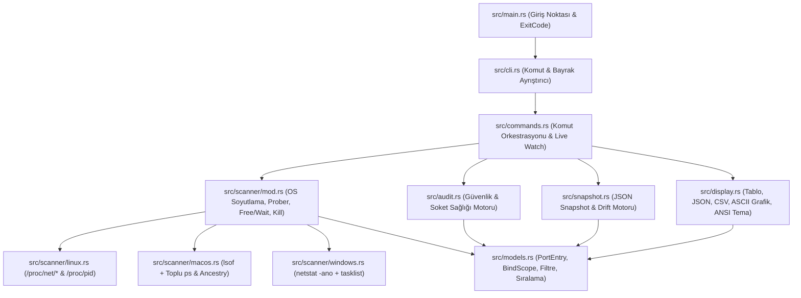

# SierraPort — Kapsamlı Sistem Mimarisi ve Kullanım Rehberi

**SierraPort**, Rust (Edition 2024) ile **sıfır harici bağımlılık** (yalnızca `std`) kullanılarak geliştirilmiş; yüksek hızlı, hafif ve çapraz platformlu bir terminal port izleme, güvenlik denetimi, adli süreç inceleme ve ağ analiz sistemidir.

---

## 1. Tasarım Felsefesi ve Mimari

SierraPort üç temel prensip üzerine kuruludur:

1. **Sıfır Harici Bağımlılık (`Cargo.toml` içinde crate yok):**
   - Tedarik zinciri (supply-chain) riskini sıfıra indirir.
   - Derleme süresi saniyeler sürer, ortaya tek bir küçük native binary çıkar (`opt-level = 3`, `lto = true`, `strip = true`).
2. **İşletim Sistemine Özgü En Hızlı Veri Toplama:**
   - Her platformda en doğrudan ve en düşük maliyetli mekanizmayı kullanır.
3. **İnsan + Makine Dostu Çıktı:**
   - Terminalde renkli tablolar, ASCII çubuk grafikleri ve titremesiz canlı panel (TUI); otomasyon ve CI/CD için `--json`, `--csv`, `--compact`, `--plain` ve anlamlı çıkış kodları (`0`, `1`, `2`).

### Modül Mimarisi



---

## 2. Sistem Nasıl Çalışır? (Teknik Derinlik)

### 2.1. İşletim Sistemine Göre Soket ve Süreç Toplama

| Platform | Yöntem | Toplanan Veriler | Performans Özelliği |
|---|---|---|---|
| **Linux** | `/proc/net/{tcp,tcp6,udp,udp6}` + `/proc/<pid>/fd` + `/proc/<pid>/{comm,cmdline,status}` + `/etc/passwd` | Protokol, yerel/uzak IP:Port, durum, PID, PPID, kullanıcı adı, VmRSS bellek, tam komut satırı | **Sıfır alt süreç** — doğrudan kernel sanal dosya sisteminden okur |
| **macOS** | `lsof -nP -iTCP -iUDP` + tek seferlik toplu `ps -o pid=,ppid=,rss=,user=,args= -p <pids>` | Protokol, yerel/uzak IP:Port, durum, PID, PPID, kullanıcı, RSS bellek, tam komut satırı | N süreç için N kez `ps` çalıştırmak yerine **tek toplu `ps` çağrısı** yapar |
| **Windows** | `netstat -ano` + `tasklist /FO CSV /NH` | Protokol, yerel/uzak IP:Port, durum, PID, süreç adı, bellek kullanımı | Harici kurulum veya PowerShell gerektirmez |

### 2.2. Bind Kapsamı (Exposure) Sınıflandırması

Her dinleyen soketin yerel IP adresi otomatik olarak analiz edilerek 4 güvenlik kapsamından birine atanır:

- **`LOCAL` (Yeşil):** `127.0.0.1`, `::1`, `localhost` — yalnızca yerel makineden erişilebilir.
- **`LAN` (Camgöbeği):** Özel ağlar (`10.0.0.0/8`, `172.16.0.0/12`, `192.168.0.0/16`), link-local (`169.254.x.x`, `fe80::/10`) ve IPv6 ULA (`fc00::/7`).
- **`ALL(*)` (Sarı):** `0.0.0.0`, `::`, `*` — makinedeki **tüm ağ arayüzlerinden** (LAN, Wi-Fi, VPN, varsa genel IP) erişime açık.
- **`PUBLIC` (Kırmızı):** Doğrudan yönlendirilebilir genel (public) IP adresine bağlı.

### 2.3. Otomatik Runtime / Container Etiketleme

Süreç adı ve komut satırı incelenerek soketlere bağlam etiketleri eklenir:
- `[container]` (Docker, containerd, Podman, Colima, OrbStack)
- `[database]` (PostgreSQL, MySQL/MariaDB, Redis, MongoDB)
- `[proxy/web]` (Nginx, Apache/httpd, Caddy, HAProxy, Envoy)
- `[js/ts]` (Node.js, Bun, Deno)
- `[python]` (Python, Uvicorn, Gunicorn)
- `[jvm]` (Java, Gradle)

### 2.4. Titremesiz Canlı İzleme (`watch` — In-Place Alternate Screen)

`sierraport watch` komutu standart ekrana alt alta yeni metin blokları basmak yerine gerçek bir terminal paneli gibi çalışır:

1. **Alternate Screen Buffer (`\x1b[?1049h`)** açılır ve imleç gizlenir (`\x1b[?25l`). Böylece terminal geçmişiniz (scrollback) kirlenmez.
2. Her yenileme döngüsünde tüm ekran (üst istatistik şeridi + port tablosu + son değişiklikler) tek bir bellek tamponunda (string buffer) oluşturulur.
3. `\x1b[H` (sol üst köşeye git), her satır sonunda `\x1b[K` (satır sonunu temizle) ve en altta `\x1b[J` (ekran sonunu temizle) dizileriyle **tek bir atomik `write_all` + `flush`** çağrısında ekrana yazılır — sıfır titreme (flicker-free).
4. `SIGINT` (`Ctrl+C`) yakalanır; RAII `WatchTerminalGuard` sayesinde imleç yeniden görünür yapılır ve ana terminal ekranınız bozulmadan geri yüklenir.

### 2.5. Çok İş Parçacıklı Port Tarama ve Banner Tespiti (`check`)

- Hedef hostname yalnızca bir kez DNS üzerinden çözümlenir.
- Ayarlanabilir iş parçacığı havuzu (`-c` / `--concurrency`, varsayılan 64, üst sınır 256) ile yüksek hızda paralel `TcpStream::connect_timeout` çalıştırılır.
- `--banner` etkinleştirildiğinde:
  1. Önce pasif okuma (180ms) ile sunucunun kendiliğinden gönderdiği karşılama mesajları yakalanır (SSH, SMTP, FTP, MySQL).
  2. Sunucu sessizse güvenli bir aktif prob gönderilir (6379 için `PING\r\n`, diğerleri için `HEAD / HTTP/1.0`).
  3. Yanıttan protokol (`HTTP`, `SSH`, `Redis`, `SMTP`, `FTP`, `MySQL`, `TLS`) ve varsa HTTP `Server` başlığı çıkarılır.

### 2.6. Güvenlik & Soket Sağlığı Denetim Motoru (`audit`)

Sistem 100 puan üzerinden başlar ve tespit edilen bulgulara göre puan düşerek `A–F` notu hesaplar:

| Seviye | Puan Kesintisi | Örnek Kural |
|---|---|---|
| **CRITICAL** | `-25` | Dışa açık (`ALL(*)` / `PUBLIC`) Redis (6379), MongoDB (27017), Elasticsearch (9200), Memcached (11211), Docker TCP (2375), etcd (2379), Telnet (23) |
| **HIGH** | `-15` | Dışa açık PostgreSQL (5432), MySQL (3306), MSSQL (1433), RabbitMQ (5672), Kafka (9092), VNC (5900), RDP (3389), SMB (445), Jupyter (8888) |
| **MEDIUM** | `-7` | Şifresiz eski protokoller (FTP 21, Telnet 23, LDAP 389) veya `>= 20` adet `CLOSE_WAIT` soketi (olası bağlantı/FD sızıntısı) |
| **LOW** | `-3` | Dışa açık geliştirme sunucusu portları (3000, 5000, 5173, 8000, 8080) veya `>= 100` adet `TIME_WAIT` soketi |
| **INFO** | `0` | Yetkisiz erişim nedeniyle PID bilgisi gizli `< 1024` ayrıcalıklı portlar |

### 2.7. Baseline Snapshot ve Drift Motoru (`snapshot` / `diff`)

- `snapshot save <dosya>`: Dinleyen portları `(protokol, yerel adres, port, durum, PID, kullanıcı, süreç)` şeklinde deterministik bir JSON dosyasına yazar.
- `diff <dosya>`: Kaydedilen baseline ile canlı sistemi `(protokol, port)` slotları üzerinden karşılaştırır:
  - `+ ADDED`: Baseline'da olmayan yeni açılmış portlar.
  - `- REMOVED`: Baseline'da olup artık kapanmış portlar.
  - `~ CHANGED`: Aynı portta süreç adı, kullanıcı, bind adresi veya PID değişmişse (ör. servis yeniden başlatma veya port devralma/hijacking şüphesi).

---

## 3. Kurulum ve Başlangıç

### Kaynaktan Derleme
```bash
git clone <repo-url>
cd SierraPort
cargo build --release
```
Derlenen binary: `./target/release/sierraport`

### Sisteme Global Kurulum
```bash
cargo install --path .
# Artık her dizinden doğrudan kullanılabilir:
sierraport --version
```

---

## 4. Kapsamlı Komut Referansı

### 4.1. `list` (`ls`) — Portları Listele
Varsayılan olarak yalnızca dinleyen (`LISTEN` / bound UDP) portları gösterir.
```bash
sierraport                           # Dinleyen portlar
sierraport list --wide               # USER, MEM ve tam COMMAND sütunları
sierraport list --all                # ESTABLISHED, TIME_WAIT, CLOSE_WAIT dahil tümü
sierraport list --tcp --exposed      # Sadece dışa açık TCP portları
sierraport list --state CLOSE_WAIT   # Sadece belirli soket durumundaki bağlantılar
sierraport list --user root          # Belirli kullanıcıya ait soketler
sierraport list --proc node          # Süreç adı veya komut satırında 'node' geçenler
sierraport list -p 80,443,3000-3100  # Port listesi veya aralığı filtresi
sierraport list --sort mem --desc    # Bellek kullanımına göre azalan sıralama
sierraport list --csv                # CSV dışa aktarma
sierraport list --json               # JSON dışa aktarma
sierraport list --compact            # Tek satırlık özet görünüm
```

### 4.2. `watch` (`monitor`, `w`) — Canlı Panel (In-Place)
Ekranı kaydırmadan, aynı terminal alanında anlık istatistikleri ve port değişikliklerini günceller.
```bash
sierraport watch                                    # 1000ms aralıkla canlı izleme
sierraport watch -i 500 --wide                      # 500ms aralıkla geniş görünüm
sierraport watch -i 500 --exposed --alert-new       # Yeni dışa açık port açılınca sesli uyarı
sierraport watch --log /tmp/port_events.jsonl       # Açılan/kapanan portları JSONL dosyasına kaydet
```

### 4.3. `inspect` (`info`, `deep`) — Derin Adli İnceleme
```bash
sierraport inspect 5432                 # Bağlantılar, süreç soyağacı, aktif peer'lar
sierraport inspect 5000 --probe         # + Canlı TCP/HTTP/banner probu
sierraport inspect 5000 --probe --json  # JSON formatında tam rapor
```

### 4.4. `audit` (`sec`, `security`) — Güvenlik & Sağlık Denetimi
```bash
sierraport audit            # Renkli güvenlik skoru ve öneriler
sierraport audit --strict   # HIGH/CRITICAL bulgu varsa exit code 1 ile çık (CI/CD)
sierraport audit --json     # SIEM / otomasyon sistemleri için JSON çıktı
```

### 4.5. `snapshot` & `diff` — Baseline ve Sapma Kontrolü
```bash
sierraport snapshot save baseline.json          # Mevcut durumu kaydet
sierraport diff baseline.json                   # Sapmaları raporla
sierraport diff baseline.json --fail-on-drift   # Sapma varsa exit code 1 ile çık
```

### 4.6. `check` (`probe`, `ping`) — Eşzamanlı Port Tarayıcı
```bash
sierraport check 80,443,5432,6379 127.0.0.1
sierraport check 1-1024 127.0.0.1 --open-only --banner
sierraport check 8000-8500 10.0.0.5 -t 250 -c 128 --open-only
```

### 4.7. `free` (`available`) — Boş Port Bulucu
```bash
sierraport free                                    # 3000-9999 aralığında 1 boş port
sierraport free --range 8000-8999 --count 5        # 5 adet boş port
PORT=$(sierraport free --range 8000-8999 --plain)  # Shell script içinde kullanım
```

### 4.8. `wait` — Port Hazır / Kapanma Bekleyici
```bash
sierraport wait 5432 --until open --timeout 30000      # Veritabanı açılana kadar bekle
sierraport wait 3000 --until closed --timeout 10000    # Servis kapanana kadar bekle
```

### 4.9. `who` (`find`, `pid`) ve `kill` — Hızlı Sorgu ve Sonlandırma
```bash
sierraport who 3000                       # 3000 portunu kim tutuyor?
sierraport kill 3000                      # Onay isteyerek SIGTERM gönder
sierraport kill 3000 -y --wait            # Onaysız sonlandır ve portun boşaldığını doğrula
sierraport kill 3000-3005 -f -y           # Aralıktaki tüm süreçlere SIGKILL gönder
sierraport kill --pid 12345 -y            # Doğrudan PID ile sonlandır
sierraport kill --proc vite -y --wait     # Süreç adına göre sonlandır
```

### 4.10. `stats` (`summary`) — Görsel Soket İstatistikleri
```bash
sierraport stats          # Protokol, durum, bind kapsamı ve süreçler için ASCII çubuk grafikler
sierraport stats --json   # JSON istatistik özeti
```

---

## 5. Gerçek Dünya Kullanım Alanları

### 1. Yerel Yazılım Geliştirme (Developer Productivity)
- **"Address already in use" hatasını 1 saniyede çözme:** `sierraport who 3000` ile portu tutan süreci görün, `sierraport kill 3000 -y --wait` ile temizce kapatıp portun serbest kaldığından emin olun.
- **Dinamik port tahsisi:** Mikroservis veya paralel test ortamlarında çakışma olmadan boş port bulmak için `PORT=$(sierraport free --range 4000-4999 --plain)`.
- **Servis bağımlılığı senkronizasyonu:** Entegrasyon testlerinden önce `sierraport wait 5432 --until open` ile veritabanının hazır olmasını bekleyin.

### 2. DevSecOps ve Güvenlik Denetimi
- **Yanlışlıkla dışa açılan servisleri yakalama:** Docker/yerel geliştirme sırasında `0.0.0.0` üzerinde unutulan Redis, PostgreSQL veya MongoDB portlarını `sierraport audit` ile anında görün.
- **CI/CD güvenlik kapısı (Security Gate):** Dağıtım sonrası (post-deploy) pipeline'da `sierraport audit --strict` çalıştırarak kritik port maruziyeti durumunda pipeline'ı otomatik durdurun.

### 3. SRE / Sunucu Operasyonları ve Konfigürasyon Sapması (Drift)
- **Üretim sunucusu baseline kontrolü:** Sunucu temiz kurulduğunda `sierraport snapshot save /etc/sierraport-baseline.json` alın; cron job veya izleme ajanından periyodik `sierraport diff /etc/sierraport-baseline.json --fail-on-drift` çalıştırarak yetkisiz açılan portları veya beklenmedik süreç değişimlerini yakalayın.
- **Olay kaydı (Audit Trail):** `sierraport watch --log /var/log/sierraport-events.jsonl` ile geçici (ephemeral) olarak açılıp kapanan şüpheli portları zaman damgasıyla kaydedin.

### 4. Olay Müdahalesi ve Adli Analiz (Incident Response / Forensics)
- **Bilinmeyen bir portun kaynağını çözme:** `sierraport inspect <port> --probe` komutuyla portun arkasındaki sürecin hangi üst süreçten (`launchd` / `systemd` / `sshd` / `bash`) türediğini (ancestry), hangi kullanıcıyla çalıştığını, ne kadar bellek tükettiğini ve dışarıya hangi banner'ı verdiğini tek komutta görün.
- **Soket sızıntısı teşhisi:** Sunucuda dosya tanımlayıcı (FD) tükenmesi yaşandığında `sierraport list --all --state CLOSE_WAIT --sort process` ile bağlantıları kapatmayan uygulamayı hızla izole edin.

### 5. Otomasyon ve Veri Boru Hatları (JSON / CSV + `jq`)
```bash
# Dışa açık tüm portları ve süreçlerini jq ile filtrele
sierraport list --exposed --json | jq '.[] | "\(.local_port) -> \(.process) (\(.user))"'

# Raporlama için CSV olarak dışa aktar
sierraport list --all --csv > sockets_report.csv
```

---

## 6. Çıkış Kodları (Exit Codes)

| Çıkış Kodu | Anlamı |
|---|---|
| `0` | İşlem başarılı (veya `--strict` / `--fail-on-drift` kontrollerinden temiz geçti) |
| `1` | Çalışma zamanı hatası, zaman aşımı (`wait`), `--strict` audit başarısızlığı veya `--fail-on-drift` sapma tespiti |
| `2` | Geçersiz CLI argümanı veya sözdizimi hatası |
