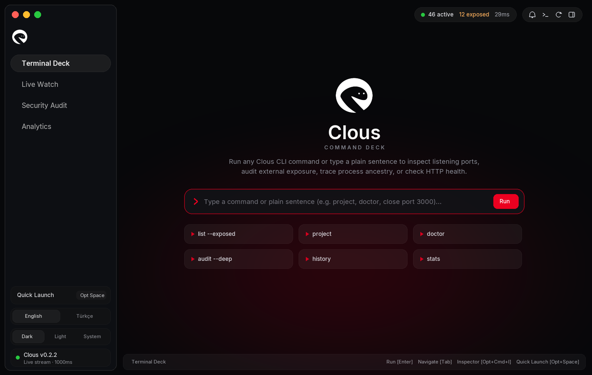
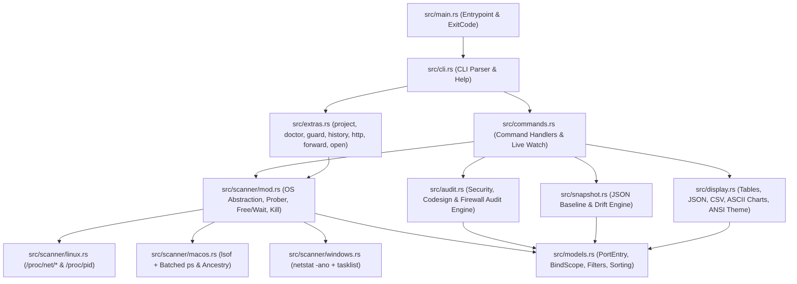

<p align="center">
  <picture>
    <source media="(prefers-color-scheme: dark)" srcset="assets/clous-banner-dark.svg" />
    <source media="(prefers-color-scheme: light)" srcset="assets/clous-banner-light.svg" />
    
  </picture>
</p>

<p align="center">
  <strong>A fast, zero-dependency Rust CLI &amp; native macOS SwiftUI desktop app for real-time port monitoring, security auditing, forensic inspection, project port mapping, and network diagnostics.</strong>
</p>

<p align="center">
  
  
  
  
  
</p>

<p align="center">
  
</p>

---

**Clous** drops right into your terminal and macOS desktop as a single, self-contained native toolchain—zero external crates, zero runtime overhead, and millisecond visibility. Whether you are resolving a local port conflict, auditing externally exposed databases, grouping active ports by Git repository, opening or forwarding local ports, tracing process ancestry trees, or enforcing port baselines in CI/CD, Clous delivers instant answers.

> Looking for Turkish documentation? See [DOCS.md](DOCS.md) · Engineering & Development Log: [DEVELOPMENT_LOG.md](DEVELOPMENT_LOG.md).

---

## Install Clous

### macOS Desktop App (`Clous.app`)

**Option 1 — Direct DMG Download (Recommended):**
Download the latest signed macOS installer from [GitHub Releases](https://github.com/efekanbahceci/clous/releases/latest/download/Clous.dmg), drag **Clous** into **Applications**, and launch.

**Option 2 — One-Line Terminal Installer:**
```bash
curl -fsSL https://github.com/efekanbahceci/clous/releases/latest/download/install.sh | bash
```

**Option 3 — Homebrew Tap:**
```bash
brew install --cask efekanbahceci/tap/clous
```

### Build from Source (CLI + Native macOS App)

```bash
git clone https://github.com/efekanbahceci/clous.git
cd clous

# Build the zero-dependency Rust CLI
cargo build --release

# Install CLI globally
cargo install --path .

# Build & bundle the native macOS SwiftUI app (dist/Clous.app)
./scripts/build-macos-app.sh
open dist/Clous.app
```

---

## Key Highlights

- **Zero External Dependencies (`std` only):** Zero supply-chain bloat in both the Rust CLI (`Cargo.toml`) and SwiftUI macOS client (`Package.swift`), sub-second incremental compiles, and a tiny standalone binary.
- **Native macOS Desktop Client (`Clous.app`):**
  - **Command Deck & Bilingual Natural Language Engine:** Run any `clous` CLI command or type a plain sentence in **English or Turkish** (e.g. `"close port 3000"`, `"open port 8080"`, `"show exposed ports"`, `"hangi projeler çalışıyor"`).
  - **Live Language & Theme Switching:** Switch seamlessly between **English / Türkçe** and **Dark (`#07080A`) / Light (`#FFFFFF`) / System** with Apple Liquid Glass surfaces and `#EB0020` Crimson accents.
  - **Privileged Action Approval Sheet:** Sensitive actions (`kill`, `open --public`) prompt with a native Liquid Glass confirmation dialog supporting instant `Enter (⏎)` approve, `Esc` cancel, and Allow Once / Remember Permission.
  - **Live Auto-Updater (`Restart Update`):** Checks GitHub Releases `latest.json` with SHA-256 verification and atomic swap + rollback.
  - **Global Quick Launcher (`⌥ Space`) & Menu Bar Monitor:** System-wide floating Spotlight-style launcher and persistent Menu Bar live status.
- **Native OS-Level Speed:** Reads `/proc/net/*` and `/proc/<pid>/*` directly on Linux with zero subprocesses; uses `lsof` + single batched `ps` enrichment on macOS; uses `netstat -ano` + `tasklist` on Windows.
- **Flicker-Free In-Place Live Dashboard:** `watch` renders into the terminal's alternate screen buffer (`\x1b[?1049h`) with atomic single-write refreshes—never polluting scrollback.
- **Built for Humans & CI/CD Pipelines:** Rich ANSI tables, wide views, and ASCII bar charts for interactive terminal use; `--json`, `--csv`, `--compact`, `--plain`, and deterministic exit codes for scripts and pipelines.

---

## Architecture & How It Works



### 1. Platform-Native Socket & Process Discovery

| Platform | Mechanism | Collected Metadata | Performance Design |
|---|---|---|---|
| **Linux** | `/proc/net/{tcp,tcp6,udp,udp6}` + `/proc/<pid>/fd` + `/proc/<pid>/{comm,cmdline,status}` + `/etc/passwd` | Protocol, local/remote `IP:Port`, state, PID, PPID, username, VmRSS memory, full command line | **Zero subprocesses** — parses kernel virtual filesystem directly |
| **macOS** | `lsof -nP -iTCP -iUDP` + single batched `ps -o pid=,ppid=,rss=,user=,args= -p <pids>` | Protocol, local/remote `IP:Port`, state, PID, PPID, username, RSS memory, full command line | **1 batched `ps` call** for all unique PIDs instead of N subprocesses |
| **Windows** | `netstat -ano` + `tasklist /FO CSV /NH` | Protocol, local/remote `IP:Port`, state, PID, process name, memory usage | Works out of the box with no extra tools or PowerShell overhead |

### 2. Automatic Bind Exposure Classification (`SCOPE`)
Every bound local address is automatically classified into an exposure scope:
- **`LOCAL`** *(Green)* — `127.0.0.1`, `::1`, `localhost` (loopback only).
- **`LAN`** *(Cyan)* — RFC 1918 private networks (`10.x`, `172.16-31.x`, `192.168.x`), link-local (`169.254.x`, `fe80::/10`), and IPv6 ULA (`fc00::/7`).
- **`ALL(*)`** *(Yellow)* — `0.0.0.0`, `::`, `*` (bound to **all interfaces** — reachable over LAN, Wi-Fi, VPN, or public NIC).
- **`PUBLIC`** *(Red)* — Directly bound to a publicly routable IP address.

### 3. Security & Socket Health Audit Engine (`audit`)
Evaluates all discovered sockets, macOS firewall posture, and binary code signatures on a **0–100 score (`A`–`F` grade)**:

| Severity | Penalty | Example Checks |
|---|---|---|
| **CRITICAL** | `-25` | Externally exposed (`ALL(*)` / `PUBLIC`) Redis (`6379`), MongoDB (`27017`), Elasticsearch (`9200`), Memcached (`11211`), Docker TCP (`2375`), etcd (`2379`), Telnet (`23`) |
| **HIGH** | `-15` | Externally exposed PostgreSQL (`5432`), MySQL (`3306`), MSSQL (`1433`), RabbitMQ (`5672`), Kafka (`9092`), VNC (`5900`), RDP (`3389`), SMB (`445`), Jupyter (`8888`) |
| **MEDIUM** | `-7` | Legacy plaintext protocols (`FTP 21`, `Telnet 23`, `LDAP 389`) or `>= 20` `CLOSE_WAIT` sockets (potential connection/FD leak) |
| **LOW** | `-3` | Exposed local dev servers (`3000`, `5000`, `5173`, `8000`, `8080`) on `0.0.0.0`/`*` or `>= 100` `TIME_WAIT` sockets |
| **INFO** | `0` | Privileged ports (`< 1024`) with hidden PID metadata (elevated privileges required) |

---

## Command Reference

| Command | Aliases | Description |
|---|---|---|
| `clous list` | `ls` | List active ports with exposure scope and runtime tags (default command) |
| `clous project` | `projects`, `proj`, `workspace` | Group active listening ports by working directory and Git repository/branch |
| `clous doctor` | `diag`, `health` | Run local network diagnostics (Firewall, DNS, loopback, exposed & zombie sockets) |
| `clous guard` | `sentinel`, `watch-guard` | Real-time security sentinel alerting on newly exposed or unexpected listeners |
| `clous history [port]` | `timeline`, `events` | View 24-hour local port open/close timeline stored in `~/.clous/history.jsonl` |
| `clous http <port> [/path]` | `curl`, `healthcheck` | Native HTTP/1.1 health probe returning status code, TTFB latency, and headers |
| `clous forward <from> <to>` | `proxy`, `tunnel` | Zero-dependency multithreaded local TCP port forwarder (`127.0.0.1:from → to`) |
| `clous open <port> [--public]` | `listen`, `bind`, `serve` | Open a live local TCP listener on `<port>` (`127.0.0.1` by default, or `0.0.0.0` with `--public`) |
| `clous watch` | `monitor`, `w` | Live in-place terminal dashboard with open/close diff log and optional JSONL logging |
| `clous inspect <port>` | `info`, `deep` | Deep forensic view: bindings, process ancestry tree, peer connections, and `--probe` |
| `clous audit` | `sec`, `security` | Security & socket health audit with 0–100 score, grade, and remediation advice |
| `clous snapshot save <file>` | `snap save` | Save current port state as a JSON baseline snapshot |
| `clous diff <file>` | `snapshot diff` | Detect added, removed, or changed ports against a saved snapshot |
| `clous check <ports> [host]` | `probe`, `ping` | Concurrent TCP connectivity scanner with optional `--banner` and `--open-only` |
| `clous free` | `available` | Find free, verified-bindable TCP ports in a range |
| `clous wait <port> [host]` | — | Block until a port becomes `open` or `closed` (dev & CI helper) |
| `clous who <port>` | `find`, `pid` | Quick lookup of process(es) occupying a specific port |
| `clous kill <target>` | — | Terminate process(es) by port/range, `--pid`, or `--proc`, with `--wait` verification |
| `clous stats` | `summary` | Visual ASCII bar-chart breakdown by protocol, state, exposure scope, and process |

### Filtering, Sorting & Output Options (`list` / `watch` / `stats` / `snapshot`)

| Flag | Description |
|---|---|
| `-l, --listen` | Show only listening/bound sockets (default for `list` and `watch`) |
| `-a, --all` | Show all socket states (`ESTABLISHED`, `TIME_WAIT`, `CLOSE_WAIT`, etc.) |
| `-t, --tcp` / `-u, --udp` | Filter by transport protocol |
| `-4, --ipv4` / `-6, --ipv6` | Filter by IP family |
| `--exposed` | Show only externally exposed listeners (`0.0.0.0`, `::`, `*`, public IP) |
| `--state <STATE>` | Filter by exact socket state (e.g., `ESTABLISHED`, `CLOSE_WAIT`) |
| `--user <NAME>` | Filter by process owner username |
| `-p, --port <SPEC>` | Filter by single port, comma list, or range (`80,443` or `3000-3010`) |
| `--proc <NAME>` | Filter by process name or full command line |
| `-s, --sort <FIELD>` | Sort by `port`, `pid`, `process`, `state`, `proto`, or `mem` |
| `-r, --desc` | Reverse sort order |
| `-w, --wide` | Wide table view (adds `USER`, `MEM`, and full `COMMAND`) |
| `--format <FMT>` | `table`, `json`, `csv`, or `compact` (shortcuts: `--json`, `--csv`, `--compact`) |
| `--no-color` | Disable ANSI colors (also respects `NO_COLOR` env var) |

---

## Usage Examples

### Listing, Projects & Diagnostics
```bash
# Group active dev servers by Git repository and working directory
clous project

# Run full local network & security health check
clous doctor

# Wide table sorted by memory usage (highest first)
clous list --wide --sort mem --desc

# Only externally exposed TCP listeners
clous list --tcp --exposed
```

### Live Monitoring, Port Guard & Timeline
```bash
# Refresh in-place every 500ms in wide mode
clous watch -i 500 --wide

# Real-time sentinel alerting on newly exposed ports
clous guard --exposed-only

# Inspect 24-hour port open/close history
clous history
clous history 3000
```

### HTTP Probe, Port Forwarding & Opening Ports
```bash
# Instant HTTP/1.1 health check with TTFB latency
clous http 3000 /health

# Forward local port 8080 to port 3000
clous forward 8080 3000

# Open a local TCP listener on port 3000 (Ctrl+C to stop)
clous open 3000
```

### Forensic Inspection, Auditing & CI/CD Gates
```bash
# Full process ancestry tree + live protocol banner probe
clous inspect 5432 --probe

# Security audit (exits 1 in CI if HIGH/CRITICAL findings exist)
clous audit --strict

# Baseline snapshot & drift verification
clous snapshot save baseline.json
clous diff baseline.json --fail-on-drift
```

### Developer Workflow Helpers (`free`, `wait`, `kill`)
```bash
# Allocate a free port inside a shell script
PORT=$(clous free --range 8000-8999 --plain)

# Wait for a database or dev server to start accepting connections
clous wait 5432 --until open --timeout 30000

# Gracefully terminate whatever is on port 3000 and verify it is released
clous kill 3000 -y --wait
```

---

## Exit Codes

| Code | Meaning |
|---|---|
| `0` | Success (or passed `--strict` / `--fail-on-drift` checks) |
| `1` | Runtime error, `wait` timeout, `--strict` audit failure, or `--fail-on-drift` drift detected |
| `2` | Invalid CLI arguments or syntax error |

---

## Testing

```bash
cargo test
```
Runs unit and live integration tests covering bind-scope classification, port range parsing, filtering/sorting, security audit rules, snapshot serialization/diff roundtrips, CLI parsing, and live loopback `free` / `probe` / `wait` flows.
