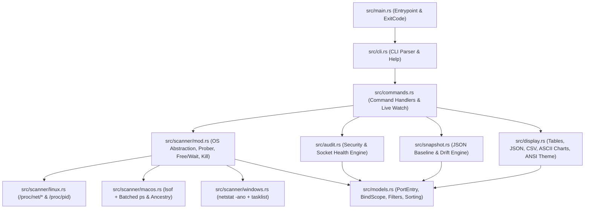

<p align="center">
  <picture>
    <source media="(prefers-color-scheme: dark)" srcset="assets/sierraport-banner-dark.svg" />
    <source media="(prefers-color-scheme: light)" srcset="assets/sierraport-banner-light.svg" />
    
  </picture>
</p>

<p align="center">
  <strong>A fast, zero-dependency Rust terminal extension for real-time port monitoring, security auditing, forensic inspection, and baseline drift detection.</strong>
</p>

<p align="center">
  
  
  
  
</p>

---

**SierraPort** drops right into your terminal as a single, tiny, self-contained native binary—no runtime, no external crates, no background daemon. Whether you are debugging a local port conflict, hunting down an accidentally exposed database, tracing a process ancestry tree, or enforcing port baselines in CI/CD, SierraPort gives you instant visibility in milliseconds.

> Looking for Turkish documentation? See [DOCS.md](DOCS.md).

---

## Quick Start

### Build from Source
```bash
git clone <repo-url>
cd SierraPort
cargo build --release
```
The optimized binary (`opt-level = 3`, `lto = true`, `strip = true`) is created at `./target/release/sierraport`.

### Install as a Global Terminal Command
```bash
cargo install --path .
```
Once installed, invoke `sierraport` from anywhere in your terminal:
```bash
sierraport                           # List all listening ports with exposure scope
sierraport watch -i 500              # Live flicker-free terminal dashboard
sierraport audit                     # Security & socket health audit (0-100 score)
sierraport inspect 5432 --probe      # Deep forensic view + live protocol/banner probe
```

---

## Why SierraPort?

- **Zero External Dependencies (`std` only):** Zero supply-chain bloat, sub-second incremental compiles, and a tiny standalone binary.
- **Native OS-Level Speed:** Reads `/proc/net/*` and `/proc/<pid>/*` directly on Linux with zero subprocesses; uses `lsof` + single batched `ps` enrichment on macOS; uses `netstat -ano` + `tasklist` on Windows.
- **Flicker-Free In-Place Live Dashboard:** `watch` renders into the terminal's alternate screen buffer (`\x1b[?1049h`) with atomic single-write refreshes—never polluting your terminal scrollback.
- **Built for Both Humans and Machines:** Rich ANSI tables, wide views, and ASCII bar charts for interactive terminal use; `--json`, `--csv`, `--compact`, `--plain`, and deterministic exit codes for scripts and CI/CD pipelines.

---

## Architecture & How It Works



### 1. Platform-Native Socket & Process Discovery

| Platform | Mechanism | Collected Metadata | Performance Design |
|---|---|---|---|
| **Linux** | `/proc/net/{tcp,tcp6,udp,udp6}` + `/proc/<pid>/fd` + `/proc/<pid>/{comm,cmdline,status}` + `/etc/passwd` | Protocol, local/remote `IP:Port`, state, PID, PPID, username, VmRSS memory, full command line | **Zero subprocesses** — parses kernel virtual filesystem directly |
| **macOS** | `lsof -nP -iTCP -iUDP` + single batched `ps -o pid=,ppid=,rss=,user=,args= -p <pids>` | Protocol, local/remote `IP:Port`, state, PID, PPID, username, RSS memory, full command line | **1 batched `ps` call** for all unique PIDs instead of N subprocesses |
| **Windows** | `netstat -ano` + `tasklist /FO CSV /NH` | Protocol, local/remote `IP:Port`, state, PID, process name, memory usage | Works out of the box with no extra tools or PowerShell overhead |

### 2. Automatic Bind Exposure Classification (`SCOPE`)
Every bound local address is automatically classified into an exposure scope:
- **`LOCAL`** *(Green)* — `127.0.0.1`, `::1`, `localhost` (loopback only).
- **`LAN`** *(Cyan)* — RFC 1918 private networks (`10.x`, `172.16-31.x`, `192.168.x`), link-local (`169.254.x`, `fe80::/10`), and IPv6 ULA (`fc00::/7`).
- **`ALL(*)`** *(Yellow)* — `0.0.0.0`, `::`, `*` (bound to **all interfaces** — reachable over LAN, Wi-Fi, VPN, or public NIC).
- **`PUBLIC`** *(Red)* — Directly bound to a publicly routable IP address.

### 3. Runtime & Container Tagging
Process names and command lines are automatically tagged for quick visual scanning:
`[container]` (Docker, containerd, Podman, Colima, OrbStack), `[database]` (PostgreSQL, MySQL, Redis, MongoDB), `[proxy/web]` (Nginx, Caddy, Envoy, HAProxy, httpd), `[js/ts]` (Node, Bun, Deno), `[python]` (Python, Uvicorn, Gunicorn), and `[jvm]` (Java, Gradle).

### 4. In-Place Live Watch Engine (`watch`)
Instead of printing new paragraphs on every tick:
1. Enters the **alternate screen buffer** (`\x1b[?1049h`) and hides the cursor (`\x1b[?25l`).
2. Composes the entire frame (live metric bar + table + recent `+ OPEN` / `- CLOSED` feed) in memory.
3. Writes the full frame atomically in a single `stdout.write_all` call using `\x1b[H` (cursor home), `\x1b[K` (erase to end-of-line), and `\x1b[J` (erase to end-of-screen).
4. Traps `SIGINT` (`Ctrl+C`) and restores your cursor and original terminal screen via a RAII `WatchTerminalGuard`.

### 5. Concurrent Port Scanner & Banner Grabber (`check`)
- Resolves the target host once and fans out across a configurable thread pool (`-c` / `--concurrency`, default `64`, up to `256`).
- With `--banner`, performs a fast passive read first (catching SSH, SMTP, FTP, MySQL greetings), then sends a lightweight active probe (`PING\r\n` on Redis 6379, or `HEAD / HTTP/1.0` otherwise) to identify protocols (`HTTP`, `SSH`, `Redis`, `SMTP`, `FTP`, `MySQL`, `TLS`) and extract server headers.

### 6. Security & Socket Health Audit Engine (`audit`)
Evaluates all discovered sockets on a **0–100 score (`A`–`F` grade)**:

| Severity | Penalty | Example Checks |
|---|---|---|
| **CRITICAL** | `-25` | Externally exposed (`ALL(*)` / `PUBLIC`) Redis (`6379`), MongoDB (`27017`), Elasticsearch (`9200`), Memcached (`11211`), Docker TCP (`2375`), etcd (`2379`), Telnet (`23`) |
| **HIGH** | `-15` | Externally exposed PostgreSQL (`5432`), MySQL (`3306`), MSSQL (`1433`), RabbitMQ (`5672`), Kafka (`9092`), VNC (`5900`), RDP (`3389`), SMB (`445`), Jupyter (`8888`) |
| **MEDIUM** | `-7` | Legacy plaintext protocols (`FTP 21`, `Telnet 23`, `LDAP 389`) or `>= 20` `CLOSE_WAIT` sockets (potential connection/FD leak) |
| **LOW** | `-3` | Exposed local dev servers (`3000`, `5000`, `5173`, `8000`, `8080`) on `0.0.0.0`/`*` or `>= 100` `TIME_WAIT` sockets |
| **INFO** | `0` | Privileged ports (`< 1024`) with hidden PID metadata (elevated privileges required) |

### 7. Baseline Snapshot & Drift Detection (`snapshot` / `diff`)
- `snapshot save <file>` writes a deterministic, zero-dependency JSON baseline of active ports.
- `diff <file>` compares live system state against the baseline by `(protocol, port)` and reports:
  - `+ ADDED` — newly opened ports not in the baseline.
  - `- REMOVED` — baseline ports no longer listening.
  - `~ CHANGED` — process name, user, bind address, or PID changes on an existing port (restarts or potential port hijacking).

---

## Command Reference

| Command | Aliases | Description |
|---|---|---|
| `sierraport list` | `ls` | List active ports with exposure scope and runtime tags (default command) |
| `sierraport watch` | `monitor`, `w` | Live in-place terminal dashboard with open/close diff log and optional JSONL logging |
| `sierraport inspect <port>` | `info`, `deep` | Deep forensic view: bindings, process ancestry tree, peer connections, and `--probe` |
| `sierraport audit` | `sec`, `security` | Security & socket health audit with 0–100 score, grade, and remediation advice |
| `sierraport snapshot save <file>` | `snap save` | Save current port state as a JSON baseline snapshot |
| `sierraport diff <file>` | `snapshot diff` | Detect added, removed, or changed ports against a saved snapshot |
| `sierraport check <ports> [host]` | `probe`, `ping` | Concurrent TCP connectivity scanner with optional `--banner` and `--open-only` |
| `sierraport free` | `available` | Find free, verified-bindable TCP ports in a range |
| `sierraport wait <port> [host]` | — | Block until a port becomes `open` or `closed` (dev & CI helper) |
| `sierraport who <port>` | `find`, `pid` | Quick lookup of process(es) occupying a specific port |
| `sierraport kill <target>` | — | Terminate process(es) by port/range, `--pid`, or `--proc`, with `--wait` verification |
| `sierraport stats` | `summary` | Visual ASCII bar-chart breakdown by protocol, state, exposure scope, and process |

### Filtering, Sorting & Output Options (`list` / `watch` / `stats` / `snapshot`)

| Flag | Description |
|---|---|
| `-l, --listen` | Show only listening/bound sockets (default for `list` and `watch`) |
| `-a, --all` | Show all socket states (`ESTABLISHED`, `TIME_WAIT`, `CLOSE_WAIT`, etc.) |
| `-t, --tcp` / `-u, --udp` | Filter by transport protocol |
| `-4, --ipv4` / `-6, --ipv6` | Filter by IP family |
| `--exposed` | Show only externally exposed listeners (`0.0.0.0`, `::`, `*`, public IP) |
| `--state <STATE>` | Filter by exact socket state (e.g., `ESTABLISHED`, `CLOSE_WAIT`) |
| `--user <NAME>` | Filter by process owner username |
| `-p, --port <SPEC>` | Filter by single port, comma list, or range (`80,443` or `3000-3010`) |
| `--proc <NAME>` | Filter by process name or full command line |
| `-s, --sort <FIELD>` | Sort by `port`, `pid`, `process`, `state`, `proto`, or `mem` |
| `-r, --desc` | Reverse sort order |
| `-w, --wide` | Wide table view (adds `USER`, `MEM`, and full `COMMAND`) |
| `--format <FMT>` | `table`, `json`, `csv`, or `compact` (shortcuts: `--json`, `--csv`, `--compact`) |
| `--no-color` | Disable ANSI colors (also respects `NO_COLOR` env var) |

---

## Usage Examples

### Listing & Filtering
```bash
# Wide table sorted by memory usage (highest first)
sierraport list --wide --sort mem --desc

# Only externally exposed TCP listeners
sierraport list --tcp --exposed

# Hunt down potential socket leaks
sierraport list --all --state CLOSE_WAIT --sort process

# Export all sockets to CSV or JSON
sierraport list --all --csv > sockets.csv
sierraport list --exposed --json | jq '.[] | "\(.local_port) -> \(.process) (\(.user))"'
```

### Live Monitoring (`watch`)
```bash
# Refresh in-place every 500ms in wide mode
sierraport watch -i 500 --wide

# Monitor exposed ports, ring terminal bell on new openings, and record JSONL audit trail
sierraport watch -i 500 --exposed --alert-new --log /tmp/port-events.jsonl
```

### Forensic Inspection (`inspect`) & Banner Scanning (`check`)
```bash
# Full process ancestry tree + live HTTP/protocol banner probe
sierraport inspect 5000 --probe

# Scan ports 1-1024 on localhost, showing only open ports and their banners
sierraport check 1-1024 127.0.0.1 --open-only --banner -c 128
```

### Security Auditing (`audit`) & Drift Detection (`snapshot` / `diff`)
```bash
# Run security audit (exits 1 in CI if any HIGH/CRITICAL findings exist)
sierraport audit --strict

# Capture a clean baseline and later verify no unauthorized ports appeared
sierraport snapshot save baseline.json
sierraport diff baseline.json --fail-on-drift
```

### Developer Workflow Helpers (`free`, `wait`, `kill`)
```bash
# Allocate a free port inside a shell script
PORT=$(sierraport free --range 8000-8999 --plain)

# Wait for a database or dev server to start accepting connections
sierraport wait 5432 --until open --timeout 30000

# Gracefully terminate whatever is on port 3000 and verify the port is released
sierraport kill 3000 -y --wait

# Terminate by process name or PID
sierraport kill --proc vite -y --wait
sierraport kill --pid 12345 -f -y
```

---

## Real-World Use Cases

1. **Local Development Productivity:** Eliminate `EADDRINUSE` friction (`who` / `kill --wait`), dynamically allocate conflict-free ports in test runners (`free --plain`), and synchronize service startup in dev scripts (`wait --until open`).
2. **DevSecOps & CI/CD Security Gates:** Catch accidentally exposed databases (`0.0.0.0:6379`, `0.0.0.0:5432`) before deployment and enforce zero critical findings with `sierraport audit --strict`.
3. **SRE & Production Drift Detection:** Snapshot known-good server port state (`snapshot save`) and run scheduled `diff --fail-on-drift` checks to detect unauthorized listeners, unexpected service restarts, or port hijacking.
4. **Incident Response & Forensics:** Trace suspicious listening ports back to their parent process chain (`launchd` / `systemd` / `sshd` / shell) with `inspect <port> --probe`, and diagnose file-descriptor leaks with `--state CLOSE_WAIT`.
5. **Automation & Pipelines:** Pipe structured `--json` or `--csv` output directly into `jq`, dashboards, or SIEM pipelines without parsing fragile `lsof`/`netstat` text.

---

## Exit Codes

| Code | Meaning |
|---|---|
| `0` | Success (or passed `--strict` / `--fail-on-drift` checks) |
| `1` | Runtime error, `wait` timeout, `--strict` audit failure, or `--fail-on-drift` drift detected |
| `2` | Invalid CLI arguments or syntax error |

---

## Testing

```bash
cargo test
```
Runs unit and live integration tests covering bind-scope classification, port range parsing, filtering/sorting, security audit rules, snapshot serialization/diff roundtrips, CLI parsing, and live loopback `free` / `probe` / `wait` flows.
